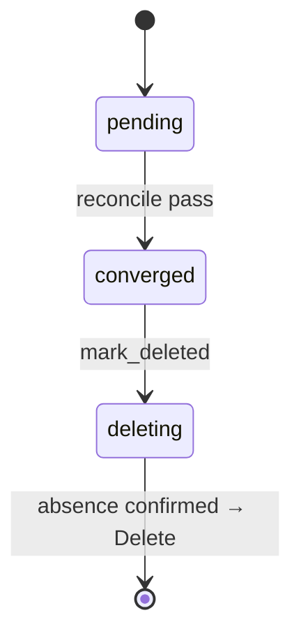
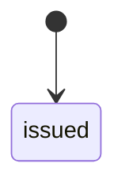
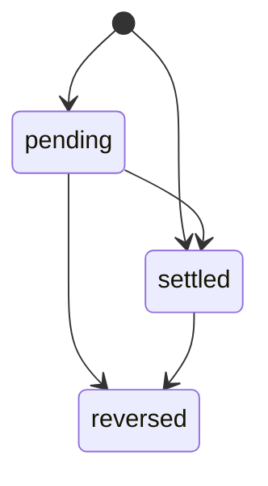
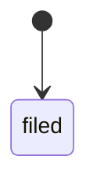
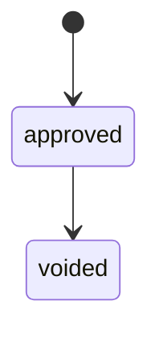

# billing flows

## `invoice` lifecycle

TODO: the state machine of this type — the phases in `status`, what moves
each transition, what the reconcile pass checks level by level, how
teardown confirms absence (the Directive §3 invariant 6).

## `payment` lifecycle

TODO: the state machine of this type — the phases in `status`, what moves
each transition, what the reconcile pass checks level by level, how
teardown confirms absence (the Directive §3 invariant 6).

## `vat_return` lifecycle

TODO: the state machine of this type — the phases in `status`, what moves
each transition, what the reconcile pass checks level by level, how
teardown confirms absence (the Directive §3 invariant 6).

## `supplier_bill` lifecycle

TODO: the state machine of this type — the phases in `status`, what moves
each transition, what the reconcile pass checks level by level, how
teardown confirms absence (the Directive §3 invariant 6).

## `invoice` in the ledger

The accounting states as `billing` reports them, and the changes the
ledger accepts (a state listing itself allows amount changes; a state with
no change out of it is terminal, its amounts frozen). Each state's desired
state is the positions in `src/ledger/invoice.rs`.

## `credit_note` in the ledger

The accounting states as `billing` reports them, and the changes the
ledger accepts (a state listing itself allows amount changes; a state with
no change out of it is terminal, its amounts frozen). Each state's desired
state is the positions in `src/ledger/credit_note.rs`.

## `payment` in the ledger

The accounting states as `billing` reports them, and the changes the
ledger accepts (a state listing itself allows amount changes; a state with
no change out of it is terminal, its amounts frozen). Each state's desired
state is the positions in `src/ledger/payment.rs`.

## `vat_return` in the ledger

The accounting states as `billing` reports them, and the changes the
ledger accepts (a state listing itself allows amount changes; a state with
no change out of it is terminal, its amounts frozen). Each state's desired
state is the positions in `src/ledger/vat_return.rs`.

## `supplier_bill` in the ledger

The accounting states as `billing` reports them, and the changes the
ledger accepts (a state listing itself allows amount changes; a state with
no change out of it is terminal, its amounts frozen). Each state's desired
state is the positions in `src/ledger/supplier_bill.rs`.

## Edge cases

| # | Trigger | Code path | Behaviour |
|---|---|---|---|
| 1 | TODO | | |
